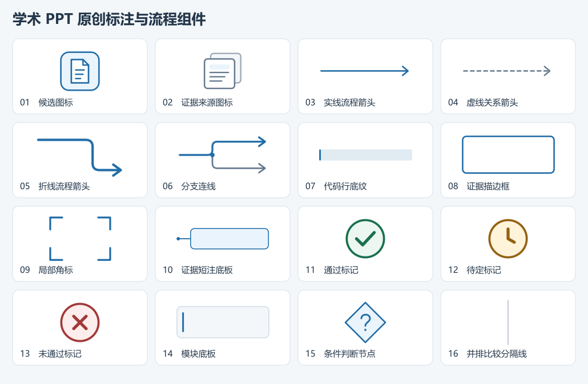

# 原创标注与流程组件

每个组件均提供透明底 SVG 和 4 倍尺寸的透明底 PNG。优先插入 SVG 以便缩放。遇到软件不支持 SVG 的情况，选择同名 PNG。用 PPT 文本框叠加可编辑标签。需要任意改动矢量形状时，可编辑 SVG 源文件，或在 PPT 中用形状重画。

| 组件 | 建议用途 | 文件 |
| --- | --- | --- |
| 候选图标 | 沿用同一个图标跟踪同一候选，可在后续点击中移动位置或沿箭头过渡。 | [SVG](SVG/01-candidate-token.svg) · [PNG](PNG/01-candidate-token.png) |
| 证据来源图标 | 贴近原表、日志或源码片段，用于标出来源，可在旁边添加来源短名。 | [SVG](SVG/02-evidence-source.svg) · [PNG](PNG/02-evidence-source.png) |
| 实线流程箭头 | 画实际经过的步骤或明确的传递。把短标签放在线的正上方。 | [SVG](SVG/03-flow-arrow.svg) · [PNG](PNG/03-flow-arrow.png) |
| 虚线关系箭头 | 标明引用、解释映射或可选路径。同页给虚线一个固定含义。 | [SVG](SVG/04-reference-arrow.svg) · [PNG](PNG/04-reference-arrow.png) |
| 折线流程箭头 | 绕开正文或图块。固定两端对象后，在讲到关联时添加这一条连线。 | [SVG](SVG/05-elbow-arrow.svg) · [PNG](PNG/05-elbow-arrow.png) |
| 分支连线 | 展示一个判断后的两条分支。分支的实际条件应在箭头旁标注。 | [SVG](SVG/06-branch-connector.svg) · [PNG](PNG/06-branch-connector.png) |
| 代码行底纹 | 置于当前代码行或表格行下层。改变宽度可覆盖一个短表达式或一行。 | [SVG](SVG/07-code-line-highlight.svg) · [PNG](PNG/07-code-line-highlight.png) |
| 证据描边框 | 叠在原图或原表上框出当前证据，框内透明。 | [SVG](SVG/08-evidence-outline.svg) · [PNG](PNG/08-evidence-outline.png) |
| 局部角标 | 标出当前需要查看的一组代码或表格单元，适合紧凑画面。 | [SVG](SVG/09-focus-corners.svg) · [PNG](PNG/09-focus-corners.png) |
| 证据短注底板 | 蓝点对准证据，在浅色板上另加一行 PPT 文本。 | [SVG](SVG/10-evidence-callout.svg) · [PNG](PNG/10-evidence-callout.png) |
| 通过标记 | 展示通过或条件满足，在附近补上可读的判定。 | [SVG](SVG/11-status-pass.svg) · [PNG](PNG/11-status-pass.png) |
| 待定标记 | 展示待核对或尚无结果，必要时说明还缺哪项依据。 | [SVG](SVG/12-status-pending.svg) · [PNG](PNG/12-status-pending.png) |
| 未通过标记 | 展示不满足或核对失败，配上判定原因。 | [SVG](SVG/13-status-fail.svg) · [PNG](PNG/13-status-fail.png) |
| 模块底板 | 为架构图保留稳定的模块位置，名称和说明使用 PPT 文本框。 | [SVG](SVG/14-module-base.svg) · [PNG](PNG/14-module-base.png) |
| 条件判断节点 | 用在逻辑图的判断位置，可把条件文字放在邻近处，避免菱形内拥挤。 | [SVG](SVG/15-condition-gate.svg) · [PNG](PNG/15-condition-gate.png) |
| 并排比较分隔线 | 在两种条件或结果之间放置，缩放高度以适配内容区。 | [SVG](SVG/16-compare-divider.svg) · [PNG](PNG/16-compare-divider.png) |

蓝色表示当前步骤或证据，灰色用于辅助关系。三种判定同时用形状和颜色区分，添加简短文字即可进一步明确含义。

在流程页中先摆好模块和文字，再按点击顺序添加候选、连线或证据框。每步完成后停住，让观众找到新增的关系。放映前从初始状态点到终态，检查底纹、箭头、标签和原图是否相互遮挡。

这些组件由本包原创绘制。可复制进个人学习、研究汇报和后续演示文稿，可按主题调色与修改。
